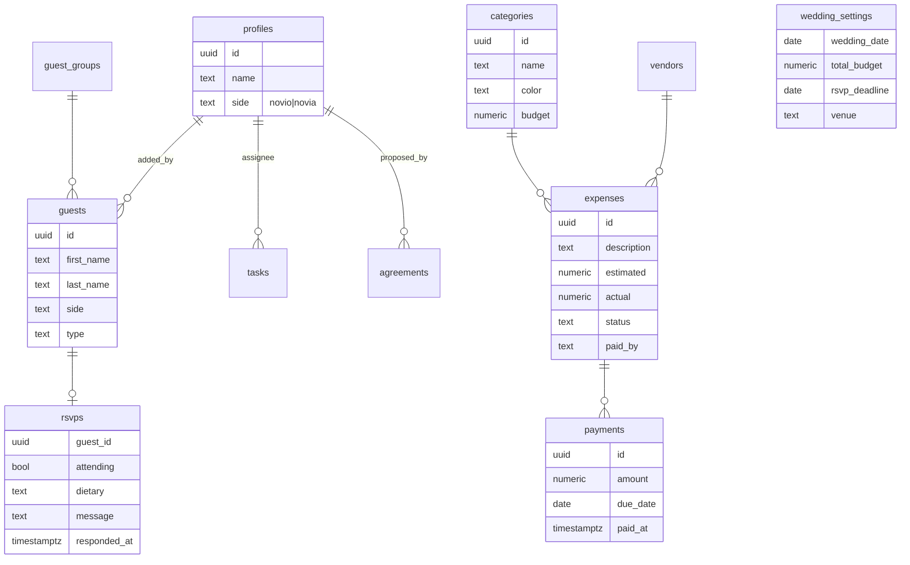

# 💍 NuestroMatri — Propuesta de PWA para planificar la boda

¡La idea está muy bien! El núcleo (presupuesto + tareas + invitados + RSVP con QR en tiempo real) es exactamente lo que más dolores de cabeza da al organizar un matri. Abajo va la propuesta técnica, lo que yo agregaría y las preguntas que necesito resolver antes de partir.

---

## 1. Stack propuesto

| Capa | Tecnología | Por qué |
|---|---|---|
| Framework | **Next.js 15 (App Router)** | Deploy nativo en Vercel, rutas públicas (RSVP) + privadas (panel) |
| Estilos | **CSS Modules + design tokens** (vanilla CSS) | Control total del diseño, look premium |
| Backend | **Supabase** (Postgres + Auth + Realtime + Storage) | Auth para ustedes dos, Realtime para confirmaciones en vivo |
| Seguridad | **Row Level Security (RLS)** | Solo ustedes ven/editan datos; el formulario público usa funciones RPC limitadas |
| PWA | **Serwist** (service worker) + `manifest.json` | Instalable en el celular, ícono, modo offline básico |
| QR | `qrcode` | Generar QR descargable (PNG/SVG) para la invitación |
| Gráficos | `recharts` | Gasto por categoría, presupuesto vs real |
| Deploy | **Vercel** | Variables de entorno de Supabase, preview por rama |

---

## 2. Módulos

### 🏠 Dashboard
- **Cuenta regresiva** (días / horas / minutos) a la fecha de la boda
- Resumen: presupuesto usado %, tareas pendientes, invitados confirmados / total
- Próximos pagos y tareas por vencer

### 💰 Presupuesto y Gastos *(funcionalidad principal)*
- Presupuesto total + **presupuesto por categoría**
- Categorías **dinámicas**: comida, adornos, vestimenta… y si no existe, se crea al vuelo desde el mismo formulario del gasto (combobox "crear «X»")
- Cada gasto: descripción, categoría, monto estimado, monto real, quién pagó (Pato / Andrea / ambos), estado (cotizado / reservado / pagado), comprobante (foto)
- Gráficos: gasto por categoría, estimado vs real, desviación del presupuesto

### ✅ Tareas
- Asignar a **Pato / Andrea / Ambos**
- Fecha límite, prioridad, estado (pendiente / en curso / lista), categoría asociada
- Vista lista y vista kanban

### 🤝 Acuerdos
- Registro de decisiones tomadas ("Máximo 120 invitados", "No niños en la fiesta"…)
- Quién lo propuso, fecha, estado (propuesto / aprobado por ambos)
- Útil para no volver a discutir lo ya decidido 😄

### 👥 Invitados
- Cada uno agrega sus invitados → se etiqueta **automáticamente** según quién está logueado:
  - **Invitados de Pato** (lado novio)
  - **Invitados de Andrea** (lado novia)
  - (opcional) **Comunes / ambos**
- Agrupación por **familia/grupo** (ej. "Familia Pérez" = 4 personas)
- Datos: nombre, apellido, tipo (adulto/niño), teléfono, notas
- Filtros y contadores por lado, por grupo y por estado de confirmación

### 📨 Confirmaciones (RSVP) con QR
- Página pública `/confirmar` (sin login) — el QR de la invitación apunta aquí
- El invitado **busca su nombre**, selecciona 1 o más personas (ej. él + su pareja + hijos) y se genera **un formulario por cada persona seleccionada**
- Por persona: ¿asiste? sí/no, restricción alimentaria, comentario
- Panel privado con **actualización en tiempo real** (Supabase Realtime): confirmados ✅, no asisten ❌, pendientes ⏳
- Generar y descargar el QR desde la app

---

## 3. Lo que yo agregaría 💡

| # | Funcionalidad | Valor |
|---|---|---|
| 1 | **Proveedores** (banquetera, fotógrafo, DJ…) con contacto y contrato adjunto | Todo en un lugar |
| 2 | **Pagos en cuotas / abonos** por proveedor con fechas de vencimiento | En los matris casi todo se paga con abono + saldo; es clave para el flujo de caja |
| 3 | **Restricciones alimentarias** en el RSVP (vegetariano, celíaco, alergias) + resumen para la banquetera | Evita la típica planilla manual |
| 4 | **Fecha límite de RSVP** y cierre automático del formulario | Control |
| 5 | **Notificaciones push** (PWA) cuando alguien confirma | Lo de "en tiempo real" llevado al celular |
| 6 | **Distribución de mesas** (drag & drop con los confirmados) | Siguiente dolor de cabeza después del RSVP |
| 7 | **Exportar** a Excel/PDF (invitados, menús, gastos) | Para compartir con proveedores |
| 8 | **Checklist plantilla** por meses ("12 meses antes", "6 meses antes"…) | Arranque rápido de tareas |
| 9 | **Lista de regalos recibidos** + check de "agradecimiento enviado" | Post-boda |
| 10 | **Cronograma del día** (hora a hora) | Para el día D |
| 11 | Canción sugerida / mensaje a los novios en el RSVP | Detalle bonito para los invitados |

---

## 4. Modelo de datos (Supabase)



**Seguridad del RSVP público:** los invitados **no** leen la tabla `guests` directamente. Usan funciones RPC (`search_guests`, `submit_rsvp`) con mínimo 3 caracteres, resultados limitados y solo exponen nombre + grupo.

---

## 5. Estructura de rutas

```
/login                      → acceso (solo Pato y Andrea)
/(panel)/                   → dashboard + countdown
/(panel)/presupuesto        → gastos, categorías, gráficos
/(panel)/tareas
/(panel)/acuerdos
/(panel)/invitados
/(panel)/confirmaciones     → realtime + generador de QR
/(panel)/ajustes            → fecha, presupuesto total, deadline RSVP
/confirmar                  → formulario público (QR)
```

---

## 6. Fases de entrega

1. **Base**: proyecto Next.js, design system, PWA, Supabase (schema + RLS), login, dashboard con countdown
2. **Presupuesto**: categorías dinámicas, gastos, gráficos
3. **Tareas + Acuerdos**
4. **Invitados + RSVP con QR + Realtime**
5. **Extras** que elijan de la sección 3

---

## 7. Preguntas abiertas ❓

> [!IMPORTANT]
> Necesito estas respuestas antes de empezar:

1. **Fecha de la boda** y **moneda** (¿CLP?).
2. **Búsqueda en el RSVP**: con un QR único y búsqueda por nombre, cualquiera con el link podría ver nombres de otros invitados. Opciones:
   - **A)** QR único + búsqueda por nombre (lo que planteaste) con mínimo 3 letras y resultados limitados
   - **B)** Un QR/código por **grupo familiar** → abre directo con su grupo precargado (más privado, pero hay que imprimir un QR distinto por invitación)
   - **C)** Ambos: QR general con búsqueda + link personalizado opcional
3. **"+1" / acompañantes**: ¿hay invitados que pueden traer acompañante sin nombre definido?
4. **Lados de invitados**: ¿solo "Pato / Andrea" o también "Comunes"?
5. ¿Qué **extras** de la sección 3 quieren en la primera versión?
6. **Estilo visual**: ¿alguna paleta o tema de la boda (ej. tonos tierra, verde salvia, dorado, blanco/negro)?
7. ¿Ya tienen **proyecto Supabase** creado o lo armamos desde cero (te dejo el SQL de migraciones)?

## 8. Verificación
- Build local (`npm run build`) y pruebas en navegador de cada módulo
- Prueba del flujo RSVP: escanear QR → buscar → confirmar varios → ver actualización en vivo en el panel
- Lighthouse para validar PWA instalable
